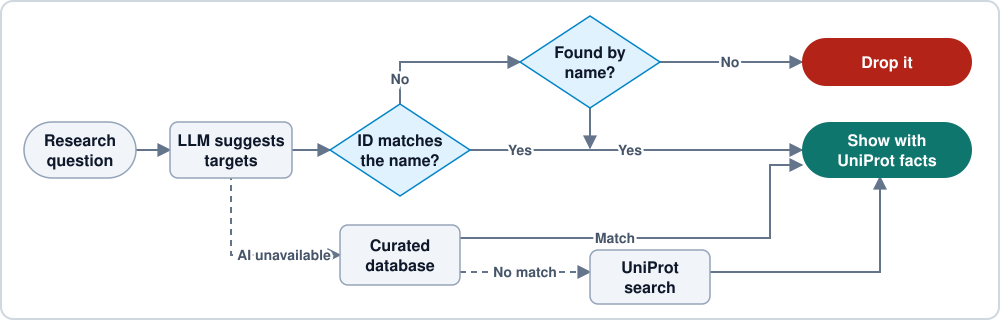
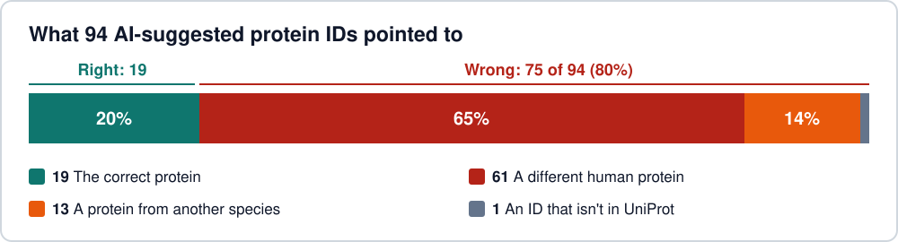

<div align="center">

# Protein Target Explorer


[](https://huggingface.co/spaces/mnoorchenar/Protein-Sequencing-AI-Discovery)
[](https://mnoorchenar.github.io/)

[](https://www.python.org/)
[](https://flask.palletsprojects.com/)
[](https://www.docker.com/)
[](https://groq.com/)
[](https://github.com/mnoorchenar/Protein-Sequencing-AI-Discovery/actions/workflows/ci.yml)
[](../LICENSE)

**LLMs often give a convincing answer with the wrong protein ID.**<br>
This app treats every suggestion as an unverified claim, and shows it only if UniProt confirms what it is.

[](#features) [](#how-it-works) [](#results) [](#documentation) [](#author)


<table>
  <tr>
    <td align="center"><h3>98%</h3>of AI suggestions verified in UniProt, up from 20%</td>
    <td align="center"><h3>73</h3>wrong AI protein IDs caught and corrected</td>
    <td align="center"><h3>160+</h3>automated tests, run on every push</td>
    <td align="center"><h3>$0</h3>to run, using free tiers only</td>
  </tr>
</table>

</div>

## Features

<table>
  <tr>
    <td width="50%"><b>Verified AI target discovery</b><br>Describe a disease or pathway in plain language, and get human targets checked against UniProt by ID and name.</td>
    <td width="50%"><b>Interactive 3D structures</b><br>View AlphaFold predictions colored by per-residue confidence, or switch to the best experimental structure from RCSB PDB.</td>
  </tr>
  <tr>
    <td><b>Protein Q&amp;A</b><br>Ask about mechanisms or clinical relevance, with answers grounded in the protein's UniProt record.</td>
    <td><b>Guided refinement</b><br>Answer a few AI-generated questions to narrow a broad search.</td>
  </tr>
  <tr>
    <td><b>Clear sources</b><br>Every result is labeled as AI-suggested, curated or a UniProt match, and AI-written text is marked for verification.</td>
    <td><b>Works without AI</b><br>If the models are down, search falls back to a curated database and then to UniProt keyword search.</td>
  </tr>
</table>

## How it works



## Results

AI models often give a real protein ID that belongs to the wrong protein. So the app compares each ID with the protein's name in UniProt, then corrects it or drops it.



<sub>Tested on 20 diseases with `gpt-oss-20b`, on 2026-11-04. This is one run of one model, checked by automated name matching and a manual review of the corrections, not an expert audit. [Rerun it](../scripts/evaluate_targets.py) or see the [full data](../docs/evaluation.json).</sub>

## Documentation

<details>
<summary><b>Getting started</b></summary>

Requires Python 3.11+. The AI features need a free [Groq API key](https://console.groq.com/keys). Without one, the curated and UniProt search paths still work.

```bash
git clone https://github.com/mnoorchenar/Protein-Sequencing-AI-Discovery.git
cd Protein-Sequencing-AI-Discovery

python -m venv venv
source venv/bin/activate     # Windows: venv\Scripts\activate
pip install -r requirements.txt

export GROQ_API_KEY=your_key # Windows PowerShell: $env:GROQ_API_KEY="your_key"
python app.py
```

Then open http://localhost:7860. Or use Docker:

```bash
docker build -t protein-target-explorer .
docker run -p 7860:7860 -e GROQ_API_KEY=your_key protein-target-explorer
```

</details>

<details>
<summary><b>Engineering decisions</b></summary>

| Decision | Why |
|---|---|
| Check the ID **and** the name against UniProt | A real human ID can still belong to an unrelated protein. Aliases and gene synonyms let `HER2` match `ERBB2`, while `Insulin receptor` doesn't match `Insulin-degrading enzyme`. |
| Prefer exact names, and look up gene symbols directly | Testing with real models showed that loose matching confuses relatives, such as `MDM2` with `MDM4`, or glucokinase with its regulatory protein. |
| Show UniProt's names and functions, not the model's | Facts on screen come from the database. Model text is limited to fields labeled as AI-written. |
| Never show a placeholder structure | A made-up model could be mistaken for real data, so the app says when no structure exists. |
| Keep prompts on the server, with a model allowlist | The API can't be used as a free general-purpose LLM proxy. |
| Render all external text with `textContent` | LLM output is untrusted, so it can't inject markup. A strict Content Security Policy adds a second layer, and a test blocks HTML-injection APIs. |
| Use one client for any OpenAI-compatible provider | The AI runs on free tiers, so changing provider is a configuration change rather than a rewrite. |
| Get AlphaFold file URLs from its API | File URLs change with each model version, so hardcoding them breaks without warning. |

</details>

<details>
<summary><b>Limitations</b></summary>

- **Relevance isn't verified.** UniProt confirms what a protein is, not that it's a good target for your question. Relevance and drug notes from the AI can still be wrong.
- **Name matching isn't perfect.** A vague or oddly formatted name from the model can resolve to a related protein, or be dropped.
- **It doesn't rank targets.** There's no scoring from genetic evidence or tractability, which a platform such as Open Targets could provide.
- **The curated database is small.** It covers 20 disease terms, and its drug notes need occasional review as approvals change.
- **The AI runs on a free tier.** Provider limits can pause AI results during heavy use, and search then falls back to curated data and UniProt.

</details>

<details>
<summary><b>Configuration</b></summary>

| Variable | Default | Purpose |
|---|---|---|
| `GROQ_API_KEY` | none | Free Groq key for the AI features |
| `HF_TOKEN` | none | Hugging Face token, used only if `GROQ_API_KEY` isn't set. It needs the **Make calls to Inference Providers** permission. |
| `PORT` | `7860` | Port to listen on |
| `LOG_LEVEL` | `INFO` | Logging verbosity |
| `LLM_RATE_LIMIT_PER_MINUTE` | `20` | Per-client limit on AI requests, per worker process. `0` turns it off. |
| `TRUST_PROXY_HOPS` | `0` (`1` in Docker) | Number of reverse proxies in front of the app, used to find the client IP |

</details>

<details>
<summary><b>API</b></summary>

All `POST` endpoints take and return JSON.

| Endpoint | Body | Returns |
|---|---|---|
| `POST /api/analyze` | `prompt`, `model` (optional) | Verified targets, with insights and their source |
| `POST /api/deep_search` | `query` | UniProt keyword matches |
| `POST /api/structure` | `uniprot_id`, `source` (optional: `pdb`) | Protein record and PDB data |
| `POST /api/ask` | `uniprot_id`, `question`, `model` (optional), `context` (optional) | AI answer |
| `POST /api/refine/question` | `original_query`, `answers`, `model` (optional) | Next clarifying question |
| `POST /api/refine/keywords` | `original_query`, `answers`, `model` (optional) | Search keywords |
| `GET /healthz` | none | Service status |

</details>

<details>
<summary><b>Tests</b></summary>

```bash
pip install -r requirements-dev.txt
ruff check .
pytest              # Fast tests with all external services mocked
pytest -m network   # Checks real UniProt, AlphaFold and RCSB responses
```

The network tests also check every curated entry against live UniProt data, which catches wrong or mislabeled IDs.

</details>

<details>
<summary><b>Project structure</b></summary>

```
app.py                  Flask app and API routes
services/
  config.py             AI providers, models and settings
  llm.py                Provider client, model fallback and output parsing
  prompts.py            All LLM prompts
  uniprot.py            UniProt client and target verification
  structure.py          AlphaFold and RCSB structure retrieval
  knowledge.py          Curated database lookup
  ratelimit.py          Per-client rate limiting
scripts/                Evaluation of AI-suggested IDs
disease_proteins.json   Curated disease-to-protein database
static/, templates/     Frontend
tests/                  Test suite
```

</details>

> [!WARNING]
> This project is for research and education only, and is not medical, clinical or pharmaceutical advice. Independently verify AI-generated content before using it.

## Author

<div align="center">
<table>
  <tr>
    <td align="center" width="170">
      <a href="https://mnoorchenar.github.io/"></a>
    </td>
    <td>
      <h3><a href="https://mnoorchenar.github.io/">Mohammad Noorchenarboo</a></h3>
      Data Scientist · AI Researcher · Biostatistician<br>
      Ontario, Canada<br><br>
      <a href="https://mnoorchenar.github.io/"></a>
      <a href="https://www.linkedin.com/in/mnoorchenar"></a>
      <a href="https://scholar.google.ca/citations?user=nn_Toq0AAAAJ&hl=en"></a>
      <a href="https://huggingface.co/mnoorchenar"></a>
      <a href="mailto:mohammadnoorchenarboo@gmail.com"></a>
    </td>
  </tr>
</table>

Released under the [MIT License](../LICENSE).

</div>
