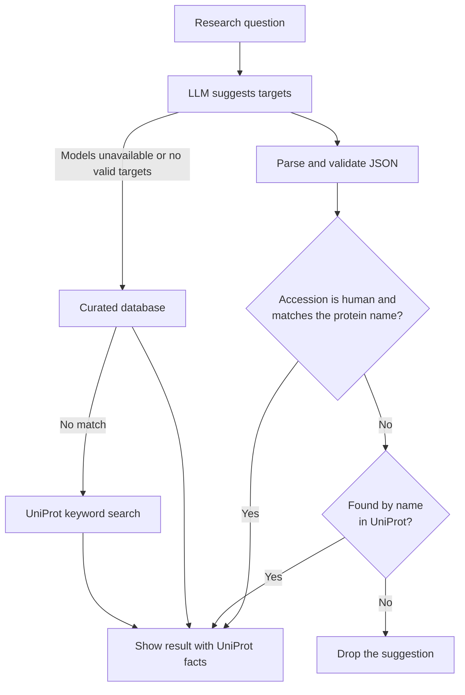

# Protein Target Explorer

[](https://github.com/mnoorchenar/Protein-Sequencing-AI-Discovery/actions/workflows/ci.yml)
[](https://huggingface.co/spaces/mnoorchenar/Protein-Sequencing-AI-Discovery)
[](LICENSE)

Turn a research question into human protein drug targets, check them against UniProt, and explore their 3D structures.

LLMs often produce a convincing explanation attached to the wrong protein ID. This project treats model output as an unverified claim: a suggestion is shown only if UniProt confirms both its identity and that it's human.


## Features

- **Verified AI target discovery:** describe a disease or pathway in plain language and get human targets that have been checked against UniProt.
- **3D structures:** view AlphaFold predictions colored by per-residue confidence (pLDDT), or switch to the highest-resolution experimental structure from RCSB PDB.
- **Protein Q&A:** ask questions answered with the protein's UniProt record as context.
- **Guided refinement:** answer a few AI-generated questions to narrow a broad search.
- **Clear sources:** every result is labeled as AI-suggested, curated or a UniProt match, and AI-written text is marked for verification.
- **Works without AI:** if the models are down, search falls back to a curated database and then to UniProt keyword search.

## How it works



## Engineering decisions

| Decision | Why |
|---|---|
| Check accession **and** name against UniProt | A real human accession can still belong to an unrelated protein. UniProt's aliases and gene synonyms let `HER2` match `ERBB2`, while `Insulin receptor` doesn't match `Insulin-degrading enzyme`. |
| Show UniProt's names and functions, not the model's | Facts on screen come from the database. Model text is limited to fields labeled as AI-written. |
| Never show a placeholder structure | A made-up model could be mistaken for real data, so the app says when no structure exists. |
| Keep prompts on the server, with a model allowlist | The API can't be used as a free general-purpose LLM proxy, and each model has a live provider. |
| Render all external text with `textContent` | LLM output is untrusted, so it can't inject markup. A strict Content Security Policy adds a second layer, and a test blocks HTML-injection APIs. |
| Use one client for any OpenAI-compatible provider | The AI runs on free tiers, so changing provider is a configuration change rather than a rewrite. |
| Get AlphaFold file URLs from its API | File URLs change with each model version, so hardcoding them breaks without warning. |
| Validate accessions and strip query syntax | User input can't alter upstream URLs or escape the human-only search filter. |

## Getting started

Requires Python 3.11+. The AI features need a free API key, and [Groq](https://console.groq.com/keys) is recommended. Without a key, the app still works, but only the curated and UniProt search paths are available.

```bash
git clone https://github.com/mnoorchenar/Protein-Sequencing-AI-Discovery.git
cd Protein-Sequencing-AI-Discovery

python -m venv venv
source venv/bin/activate    # Windows: venv\Scripts\activate
pip install -r requirements.txt

export GROQ_API_KEY=your_key  # Windows PowerShell: $env:GROQ_API_KEY="your_key"
python app.py
```

Then open http://localhost:7860.

### Docker

```bash
docker build -t protein-target-explorer .
docker run -p 7860:7860 -e GROQ_API_KEY=your_key protein-target-explorer
```

### Configuration

| Variable | Default | Purpose |
|---|---|---|
| `GROQ_API_KEY` | none | Free Groq key for the AI features |
| `HF_TOKEN` | none | Hugging Face token, used only if `GROQ_API_KEY` isn't set. It needs the **Make calls to Inference Providers** permission. |
| `PORT` | `7860` | Port to listen on |
| `LOG_LEVEL` | `INFO` | Logging verbosity |
| `LLM_RATE_LIMIT_PER_MINUTE` | `20` | Per-client limit on AI requests, per worker process. `0` turns it off. |
| `TRUST_PROXY_HOPS` | `0` (`1` in Docker) | Number of reverse proxies in front of the app, used to find the client IP |

## API

All `POST` endpoints take and return JSON.

| Endpoint | Body | Returns |
|---|---|---|
| `POST /api/analyze` | `prompt`, `model` (optional) | Verified targets, with insights and their source |
| `POST /api/deep_search` | `query` | UniProt keyword matches |
| `POST /api/structure` | `uniprot_id`, `source` (optional: `pdb`) | Protein record and PDB data |
| `POST /api/ask` | `uniprot_id`, `question`, `model` (optional), `context` (optional) | AI answer |
| `POST /api/refine/question` | `original_query`, `answers`, `model` (optional) | Next clarifying question |
| `POST /api/refine/keywords` | `original_query`, `answers`, `model` (optional) | Search keywords |
| `GET /healthz` | none | Service status |

## Tests

```bash
pip install -r requirements-dev.txt
ruff check .
pytest              # Fast tests with all external services mocked
pytest -m network   # Checks real UniProt, AlphaFold and RCSB responses
```

The network tests also check every curated entry against live UniProt data, which catches wrong or mislabeled accessions.

## Project structure

```
app.py                  Flask app and API routes
services/
  config.py             AI providers, models and settings
  llm.py                Provider client, model fallback and output parsing
  prompts.py            All LLM prompts
  uniprot.py            UniProt client and target verification
  structure.py          AlphaFold and RCSB structure retrieval
  knowledge.py          Curated database lookup
  ratelimit.py          Per-client rate limiting
disease_proteins.json   Curated disease-to-protein database
static/, templates/     Frontend
tests/                  Test suite
```

## Limitations

- **Relevance isn't verified.** UniProt confirms what a protein is, not that it's a good target for your question. Relevance and drug notes from the AI can still be wrong.
- **Name matching isn't perfect.** It corrects most wrong IDs, but a vague or oddly formatted name from the model can still resolve to a related protein.
- **It doesn't rank targets.** There's no scoring from genetic evidence or tractability, which a platform such as Open Targets could provide.
- **The curated database is small.** It covers 20 disease terms, and its drug notes need occasional review as approvals change.
- **Keyword search is literal.** UniProt matches can be only loosely related to a multi-word query.
- **The AI runs on a free tier.** Provider limits can pause AI results during heavy use, and search then falls back to curated data and UniProt.
- **Rate limits and caches are per process.** That suits a single container, but a larger deployment would need shared storage such as Redis.

## Disclaimer

This project is for research and education only, and is not medical, clinical or pharmaceutical advice. Independently verify AI-generated content before using it.

## Author

**Mohammad Noorchenarboo**, Data Scientist, AI Researcher and Biostatistician, Ontario, Canada

[LinkedIn](https://www.linkedin.com/in/mnoorchenar) · [Website](https://mnoorchenar.github.io/) · [Google Scholar](https://scholar.google.ca/citations?user=nn_Toq0AAAAJ&hl=en) · [Hugging Face](https://huggingface.co/mnoorchenar) · [Email](mailto:mohammadnoorchenarboo@gmail.com)

## License

[MIT](LICENSE)
